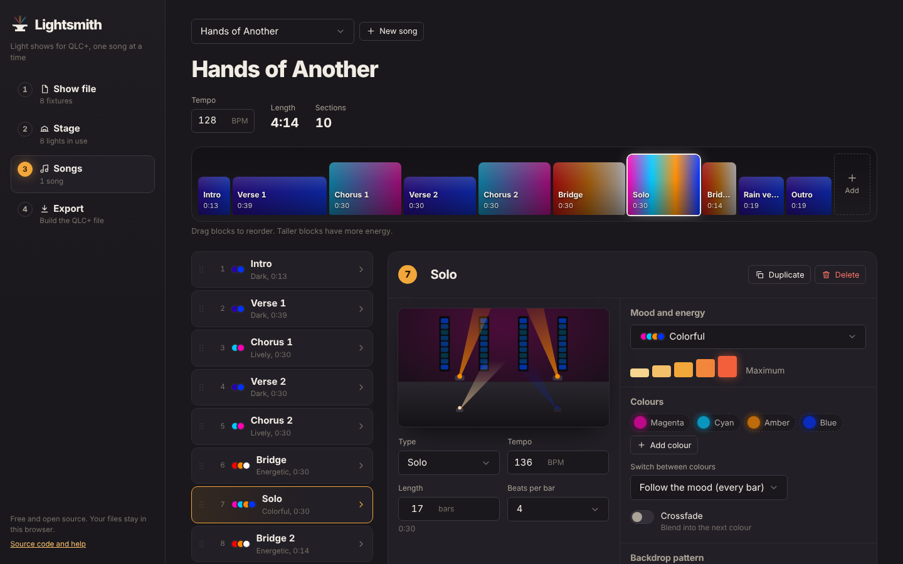
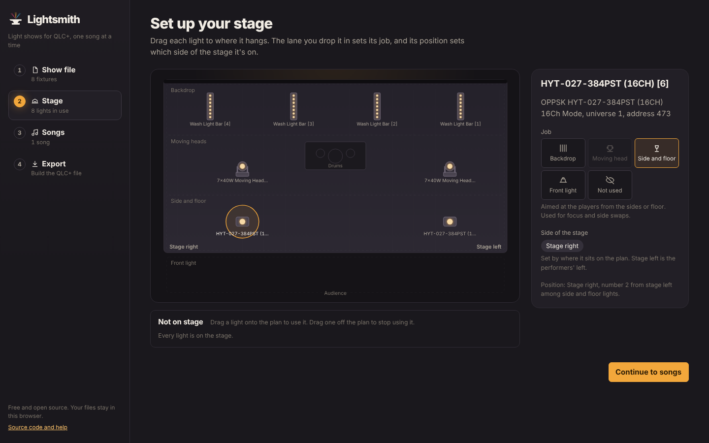

# Lightsmith

**Build QLC+ light shows song by song, from simple presets.**

Lightsmith is a free, open-source browser app for bands and anyone running lights with
[QLC+](https://www.qlcplus.org/). You describe each song in plain terms (sections, tempo, mood,
colours, movement) and Lightsmith writes the scenes, effects, chasers and Virtual Console
buttons into your QLC+ workspace. QLC+ does everything else: DMX output, MIDI and other
inputs, fixture definitions and the 3D view.

No lighting experience needed, no account, no server. Your files never leave your browser.



## What you can do

- **Place your lights on a stage plan.** Drag each light into the backdrop, moving-head, side or front lane; its position sets
  which side of the stage it's on.
- **Lay out a song.** Sections sit on a timeline (width is length, height is energy). Drag to reorder them.
- **Pick a look for each section.** Ten moods, an energy level, your own colours (gels or a colour wheel) with optional
  colour changes on the beat or bar, 21 backdrop patterns, 8 moving-head movements, a focus player and layered effects
  (rain, lightning, blinder hit, beat pulse, sparkle, strobe hits).
- **See it before you export.** A live preview sketches each section on your own stage at the song's tempo.
- **Export a clean QLC+ file** with a function folder per song, a song cue chaser and Virtual Console buttons, checked
  before you download it.

Backdrop patterns only use RGB matrix scripts that ship with both QLC+ 4.14 and QLC+ 5.2, so exported shows work in
either.



## How it works

1. **Show file.** Patch your fixtures in QLC+ as usual and save the workspace (`.qxw`). Drop it
   into Lightsmith. Fixtures from the QLC+ library are recognised automatically; for any
   definitions you made yourself, drop in their `.qxf` files.
2. **Stage.** Drag each light onto the stage plan. The lane sets its job (backdrop, moving head,
   side/floor or front light) and its position sets the side of the stage.
3. **Songs.** Add sections (Intro, Verse, Chorus…), set BPM and length, and pick a mood,
   energy, colours, pattern, movement, focus and effects for each.
4. **Export.** Lightsmith adds the song to a copy of your workspace and checks it. Open it in
   QLC+ and find the song's frame in the Virtual Console: one button per section.

Exporting the same song again replaces its previous version, so you can keep tweaking.

## Running it locally

You need [Node.js](https://nodejs.org/) 20 or newer.

```sh
npm install
npm run sync-fixtures   # optional: copies the QLC+ fixture library into public/fixtures
npm run dev             # opens the app at http://localhost:5173
```

Other commands:

| Command | What it does |
| --- | --- |
| `npm test` | Runs the engine tests |
| `npm run typecheck` | Type-checks everything |
| `npm run build` | Builds the static site into `dist/` |

## Project layout

```
src/core/      The engine. Plain TypeScript, no browser or React code.
  xml.ts         Small XML reader/writer that keeps QLC+ files intact
  fixture.ts     Reads .qxf definitions; works out dimmer, colour, pan/tilt per head
  workspace.ts   Reads .qxw workspaces and merges new content into them
  presets.ts     Colours, moods, movements and section types  <- easiest place to contribute
  model.ts       The saved project: rig and songs
  rig.ts         Matches fixtures to definitions and guesses their roles
  generate.ts    Turns a song into QLC+ functions and Virtual Console buttons
  checks.ts      Checks the result before download
src/ui/        The React app: one page per step, plus controls, colour picker, stage preview
scripts/       sync-fixtures.mjs copies the QLC+ fixture library
tests/         Engine tests (node:test)
docs/          Notes on QLC+ behaviour the generator relies on
```

## Contributing

Ideas, bug reports and pull requests are welcome. See [CONTRIBUTING.md](CONTRIBUTING.md). New moods,
colours and movements are a great first contribution: they live in `src/core/presets.ts`.

## Licence

Lightsmith is licensed under the [Apache License 2.0](LICENSE). It bundles the QLC+ fixture
library, © the QLC+ project, also under the Apache License 2.0; see [NOTICE](NOTICE).
Lightsmith is an independent project and isn't affiliated with QLC+.
