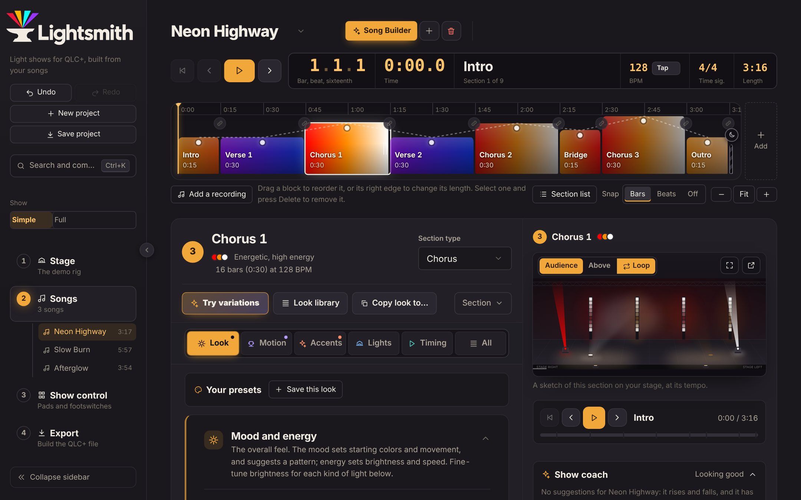
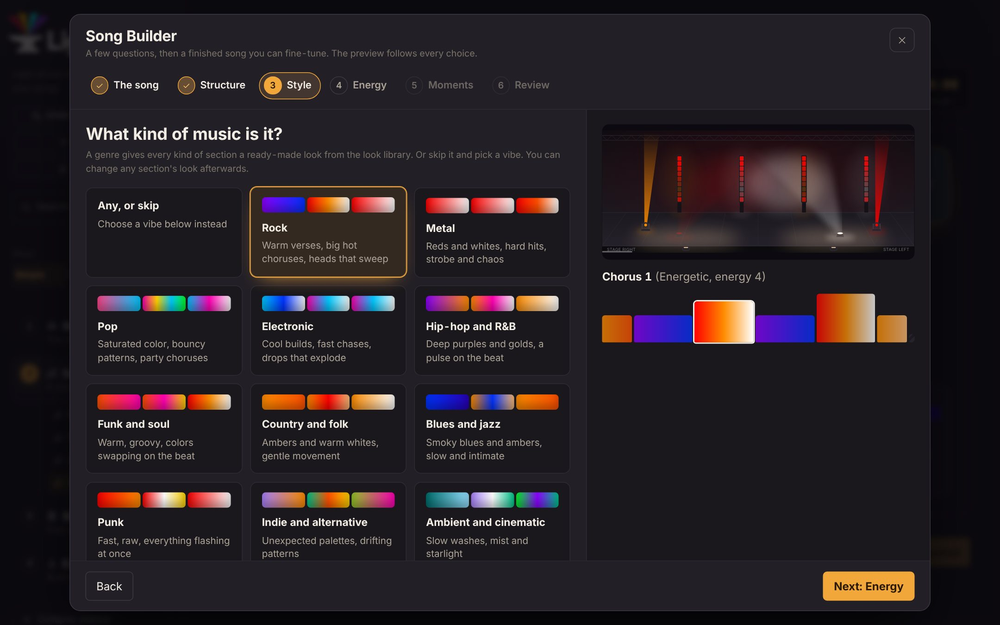
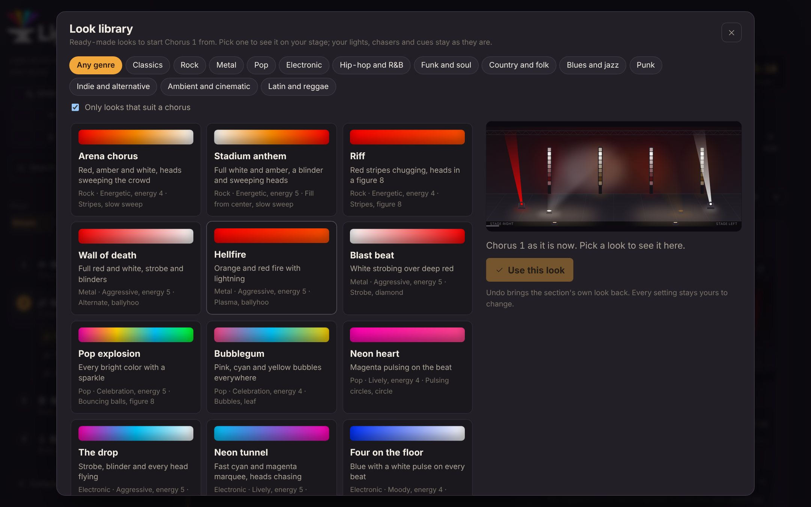
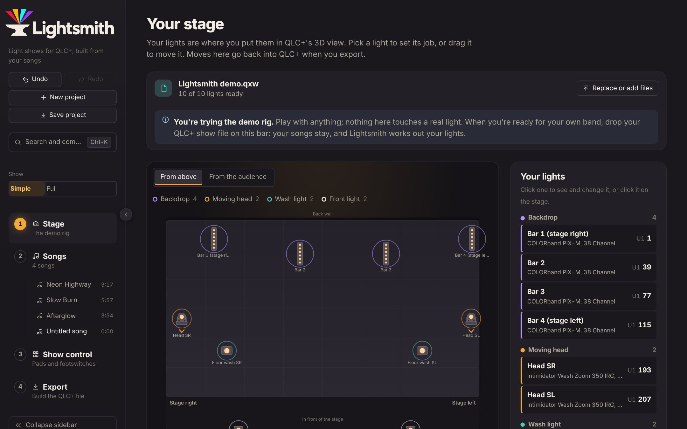
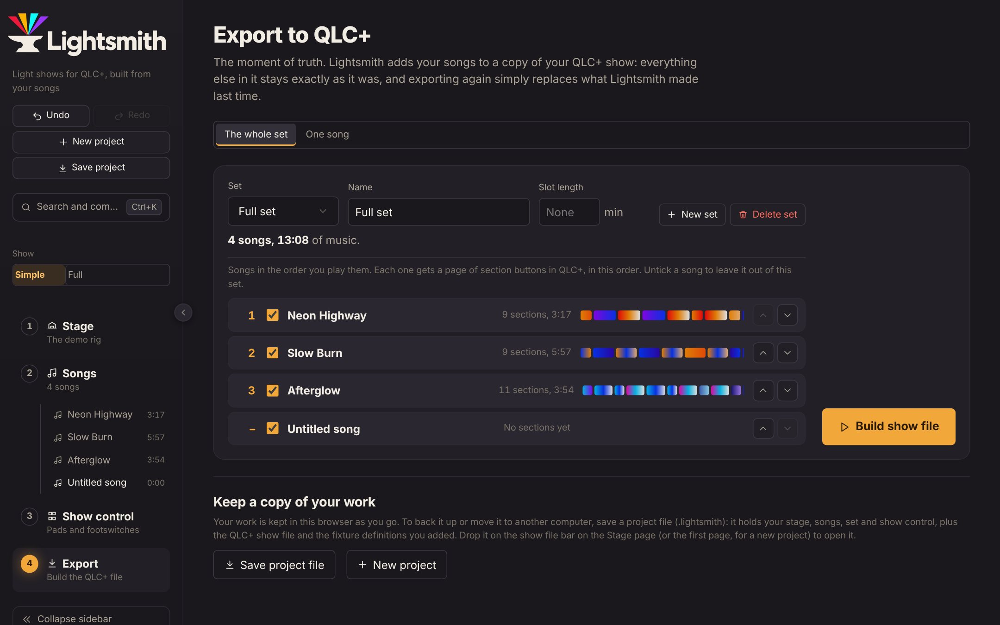

# Lightsmith

**Light the songs, not the fixtures.**

Lightsmith is a free, open-source browser app that turns your band's songs into a
[QLC+](https://www.qlcplus.org/) light show. You think like a musician (intro, verse, big
chorus, blackout on the last hit) and Lightsmith writes the hundreds of scenes, effects,
chasers and Virtual Console buttons into your QLC+ show file. QLC+ runs the lights at the gig;
you get to play.

No lighting degree, no account, no server. Everything runs in your browser, and your files
never leave your computer.

### [Open Lightsmith](https://jastylr.github.io/lightsmith/) · [Read the manual](https://jastylr.github.io/lightsmith/manual.html)

No QLC+ show file yet? Click **Try the demo** on the first page: a typical small band rig
(LED bars, floor washes, front lights and two moving heads) with three songs ready to play.



## What you can do

**Build a song in a minute.** The **Song Builder** asks six quick questions (tempo, structure,
genre, how the energy moves, a few signature moments) and lays out a finished song you can
fine-tune. Got the recording? Press <kbd>M</kbd> as it plays to mark where each section starts.



**Start from a look that works.** The **look library** has 117 ready-made looks across twelve
genres, from arena-rock choruses to ambient starlight. Click a look to see it on your own
stage, then use it with one more.



**Design every section your way.** Mood and energy, your own colors and color changes on the
beat or bar, over twenty backdrop patterns, moving-head positions and movements sized in real
angles, a spotlight on one player, strobe hits in any color, lightning, blinders and your own
step-by-step chasers. Not sure? **Try variations** deals three alternatives side by side, and
the **show coach** points out a chorus that doesn't lift or a song with no ending.

**See it before the gig.** A live preview draws each section on your own stage at the song's
tempo, in sync with the recording if you add one. Pop it out onto a second screen, or go full
screen.

**Lay out your stage once.** Lightsmith reads your lights and where they stand in QLC+'s 3D
view, works out what each one is for, and lets you fix anything by dragging.



**Run the show from the stage.** Drum pads, footswitches and amp modelers cue each section
over MIDI; press **Learn** and hit the pad. Step through each song with one cue, or give
every section its own. A safe look and blackout are always a press away, and there's a
printable cheat sheet to tape to the floor.

**Keep a set for every gig.** Headline night, 30-minute support slot, acoustic set: each set
has its own songs and order, and Lightsmith adds up the running time against your slot.



**Export a clean QLC+ file.** Lightsmith adds your songs to a copy of your show (your own
functions and settings stay exactly as they were), checks the result and hands it back.
Export again whenever you change something; it replaces only what it made last time. Shows
work in QLC+ 4.14 and QLC+ 5.

## How it works

1. **Stage.** Patch your lights in QLC+ as usual and save the show (`.qxw`). Drop it into
   Lightsmith. Lights from the QLC+ fixture library are recognised straight away; for any you
   defined yourself, drop in their `.qxf` files too.
2. **Songs.** Lay out each song's sections on a timeline and give each one a look, or let the
   Song Builder do it.
3. **Show control.** Tell Lightsmith which pads and switches will cue the lights.
4. **Export.** Pick the set you're playing, download the show file and open it in QLC+.

Save the whole project as a `.lightsmith` file to back it up or move it to another computer.

## Running it locally

You need [Node.js](https://nodejs.org/) 20 or newer.

```sh
npm install
npm run sync-fixtures   # copies the QLC+ fixture library into public/fixtures
npm run dev             # opens the app at http://localhost:5173
```

Other commands:

| Command | What it does |
| --- | --- |
| `npm test` | Runs the engine tests (run `sync-fixtures` first for the demo's test) |
| `npm run typecheck` | Type-checks everything |
| `npm run build` | Builds the static site into `dist/` |
| `npx tsx scripts/make-demo.ts` | Rebuilds the demo project after changing the builder or library |

## Project layout

```
src/core/      The engine. Plain TypeScript, no browser or React code.
  xml.ts         Small XML reader/writer that keeps QLC+ files intact
  fixture.ts     Reads .qxf definitions; works out dimmer, color, pan/tilt per head
  workspace.ts   Reads .qxw shows and merges new content into them
  presets.ts     Colors, moods, patterns, movements and section types
  library.ts     The look library, by genre
  builder.ts     The Song Builder's structures, vibes, energy arcs and moments
  coach.ts       The show coach and variations
  model.ts       The saved project: rig, songs, sets and show control
  rig.ts         Matches lights to definitions and guesses their jobs
  generate.ts    Turns songs into QLC+ functions and Virtual Console buttons
  checks.ts      Checks the result before download
src/ui/        The React app: one page per step, plus the editor, previews and dialogs
public/        The manual, the demo project and (after sync) the fixture library
scripts/       sync-fixtures.mjs copies the QLC+ fixture library; make-demo.ts builds the demo
tests/         Engine tests (node:test)
docs/          Notes on QLC+ behavior the generator relies on, and screenshots
```

## Contributing

Ideas, bug reports and pull requests are welcome. See [CONTRIBUTING.md](CONTRIBUTING.md). New
looks for the library, moods, colors and movements make great first contributions: they live
in `src/core/library.ts` and `src/core/presets.ts`.

## License

Lightsmith is licensed under the [Apache License 2.0](LICENSE). It bundles the QLC+ fixture
library, © the QLC+ project, also under the Apache License 2.0; see [NOTICE](NOTICE).
Lightsmith is an independent project and isn't affiliated with QLC+.
