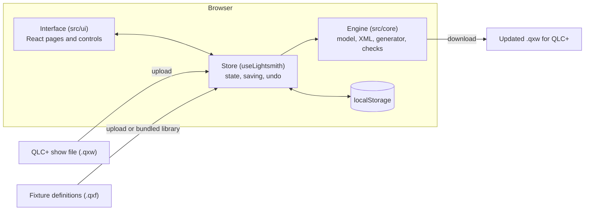

# Building Lightsmith: From a Browser App to a Full-Stack Product

*A hands-on course in TypeScript, React, Vite and Next.js, taught by building one real app, page by page*

## What this course is

This course teaches you to build Lightsmith yourself, so that afterwards you can maintain it and add to it on your own and only need help when you hit a real roadblock.

It follows the order an app is actually built in:

1. **Foundations.** What the app does, setting up the project, its structure and defaults, and the shared pieces every page relies on (the app shell, the data model, the store, the engine's building blocks).
2. **The pages, one at a time, in the order a user meets them.** Show file → Stage → Songs → Export. Each page is taught section by section, exactly as it appears on screen.
3. **Shipping it.** Building, testing and deploying, then a code audit that prepares for the next version.
4. **Part 2: the next version.** The blueprint for rebuilding Lightsmith on Next.js with a database, accounts, Stripe payments and server-side AI, again walked through page by page.

**How you'll learn: build it alongside the real thing.** In Chapter 2 you create your own fresh copy of the app (the *learner build*). Every chapter after that adds the next piece to it. The real Lightsmith repository is your answer key: when you're stuck, compare your code with the file the chapter names. By the end of Part 1 you'll have rebuilt the whole app yourself.

**Your starting point.** You know server-rendered PHP (requests, SQL, sessions, `.env`), and used C++ and Java years ago. The course skips basic programming syntax and spends its time on what's *different*: static types that vanish at runtime, components instead of templates, state that lives in the browser, build tools, and the client/server split that Next.js brings back. "Coming from PHP" boxes map each new idea onto what you know, and say where the comparison breaks down.

**Each chapter contains:**
- **Goals.** What you'll be able to do by the end.
- **On screen.** The part of the app the chapter builds, so you always know what you're making.
- **Files.** The real files to study, with their key functions.
- **Concepts.** The technology and patterns, taught when they're first needed, not all up front.
- **Build it.** Step-by-step work in your learner build.
- **Check yourself.** Questions that confirm the ideas stuck.

**Tools you'll need:** Node.js 22 LTS, npm, Git and a GitHub account, VS Code, and a browser with developer tools. Part 2 adds Postgres, a Stripe test account and an Anthropic API key.

File paths refer to commit `9af89a9` (18 November 2026). If a line has moved, search for the function or type name.

## Diagrams and pictures

Chapters use three kinds of visuals, picked for what each idea needs:

- **Mermaid diagrams** for structure and flow: architecture, component trees, data models, sequences of events and state changes. They're written as text inside the chapter files, so GitHub draws them automatically and you can edit them like code. To see them in VS Code, install the *Markdown Preview Mermaid Support* extension.
- **Annotated screenshots** of the real app for every page and section, with numbered callouts matching the chapter's headings. They're saved in `course/images/`.
- **Small SVG sketches** where neither fits, such as the stage geometry behind the preview, or how a timeline drag maps pixels to bars and beats.

For example, here is the app's overall architecture, which Chapter 1 explains:

**Planned diagrams by chapter**

| Chapter | Diagrams |
|---|---|
| 1. What we're building | Architecture (as above); the user's journey through the four pages, with the data each produces |
| 2. Project setup | Folder structure and the import rule (`core` never imports `ui`); what happens from `index.html` to `<App />`; dev server vs production build |
| 3. JavaScript | PHP vs JavaScript request/event models; the event loop and promises |
| 4–5. TypeScript | Compile time vs runtime: where types exist and where they're gone; how Lightsmith's main types relate |
| 6–7. React | The component tree; one render cycle (state change → re-render → screen); how a controlled input works; effect lifecycle and cleanup |
| 8. App shell | Component tree of the shell; annotated screenshot of the menu and layout |
| 9. Data model | Class diagram of `Project`, `Rig`, `Song`, `Section`; how a light's color and brightness are resolved (mood and energy → kind of light → individual light) |
| 10. Store | Sequence: a click → `change()` → undo history → save; state diagram of undo with gestures |
| 11. XML toolkit | XML text → token stream → element tree → text again |
| 12. Show file | Annotated page screenshot; flowchart of `addFiles` routing each file type; how a fixture becomes a profile |
| 13–14. Stage | Annotated page screenshot; how QLC+'s 3D view becomes positions, sides and order; job versus place; sequence of a drag |
| 15–21. Songs | Annotated screenshot for each section; component tree of the Songs page; timeline resize and playback sequences; how a section's settings flow into the preview |
| 22. Export | Annotated page screenshot; flowchart of `generateSong`; which QLC+ functions one section becomes; where the Virtual Console frame is placed |
| 23. Deploying | The GitHub Actions pipeline, from push to live site |
| 24. Audit | Before/after: today's store vs the split, repository-based design |
| 25. Next.js | PHP request cycle side by side with Server and Client Components |
| 26. Migration | Target folder map; the step-by-step migration as a timeline |
| 27. Database | Entity-relationship diagram of the full schema |
| 28. Auth | Sign-in sequence; where ownership checks sit in a request |
| 29–30. Pages on the server | Sequence of autosave; sequence of a server-side export and download |
| 31. Stripe | Checkout and webhook sequence, showing what the browser can and can't be trusted with |
| 32. AI | Sequence of "Suggest a look": browser → server → Anthropic API → validation → undoable edit |
| 33–35. Shipping | Deployment architecture; the eight-milestone plan as a Gantt-style chart |

---

# Part 1 — Building the Vite + TypeScript app

## Section A — Foundations

### Chapter 1. What we're building and how it fits together

**Goals.** Understand the product, its users and its domain well enough to make design decisions yourself.

**On screen.** The whole app: the left menu's four steps, and what each page produces.

**Concepts.**
- The problem: a band wants lighting cues per song section, and QLC+ (free lighting software) runs the lights. Lightsmith writes files QLC+ opens; it never talks to the lights itself.
- Just enough lighting to follow along: DMX channels, fixtures and their *modes*, intensity vs color channels, moving heads (pan and tilt), and the QLC+ ideas the app generates: scenes, RGB matrices, EFX, chasers, collections and the Virtual Console.
- QLC+'s two file types: the workspace or show file (`.qxw`) and the fixture definition (`.qxf`). Both are XML.
- The user's journey and the data each step produces: workspace → rig → songs and sections → an updated workspace.
- The architecture in one picture: an **engine** (`src/core`, plain TypeScript, no browser code) and an **interface** (`src/ui`, React), and why keeping them apart matters (testing now, a server later).
- Why browser-only for version 1: no server costs, and the user's files never leave their computer.

**Files.** `README.md`, `docs/qlc-notes.md`, `src/core/index.ts`.

**Build it.** No code yet. Sketch the four pages on paper and list the data each one needs and produces.

**Check yourself.** Which page could you delete without the engine noticing? What would break if the engine imported React?

---

### Chapter 2. Setting up the project: tools, framework and structure

**Goals.** Create the learner build from nothing, with the same tooling, settings and folder structure as Lightsmith.

**On screen.** A blank page that says "Lightsmith", reloading instantly as you edit.

**Concepts.**
- Node.js and npm. Node runs your tools here; it doesn't serve your pages in production. `package.json` holds dependencies, dev dependencies and scripts; the lockfile and `node_modules` follow from it. *Coming from PHP: `composer.json` plus a Makefile in one file.*
- Creating a Vite + React + TypeScript project, then trimming the template down to Lightsmith's shape.
- How a browser app starts: `index.html` → `src/main.tsx` → `<App />`. No server renders pages per request.
- `tsconfig.json`, setting by setting: `strict`, `noUncheckedIndexedAccess`, `noUnusedLocals` (the setting that once failed this project's CI), `isolatedModules`, `moduleResolution: "Bundler"`, `jsx: "react-jsx"`.
- `vite.config.ts` and `base: "./"` for static hosting.
- The folder structure and its rules: `src/core` never imports `src/ui`; `tests/` mirrors the engine; `public/` is copied as-is; `scripts/` holds build helpers.
- App-wide constants in `src/config.ts` (the app's name lives in one place).
- Git and GitHub: first commit, `.gitignore`, pushing a repository.

**Files.** `package.json`, `tsconfig.json`, `vite.config.ts`, `index.html`, `src/main.tsx`, `src/config.ts`, `.gitignore`.

**Build it.** Create the project, match the settings, create the folders, and push it to a new GitHub repository.

**Check yourself.** What does `npm run dev` start, and what does `npm run build` produce? Why does the build run `tsc --noEmit` before `vite build`?

---

### Chapter 3. Modern JavaScript for a PHP developer

**Goals.** Be fluent in the JavaScript underneath TypeScript, especially where it behaves differently from PHP.

**Concepts.**
- Where JavaScript runs in this project: in the browser (the app) and in Node (tools and tests). *Coming from PHP: there's no request that starts and ends; the page stays alive and responds to events.*
- `const` and `let`, block scope, and why `var` isn't used.
- Values and comparison: `===` vs `==`, truthy and falsy, `null` vs `undefined`, numbers (one number type) and strings.
- Objects and arrays compared with PHP arrays: PHP's one array type splits into objects (keyed records), arrays (lists) and `Map`/`Set`. References vs copies.
- Functions: arrow functions, default and rest parameters, functions as values, closures (used everywhere in React).
- Destructuring and spread: `const { mood, energy } = section`, `{ ...section, bars: 8 }`. These are the backbone of Lightsmith's "copy, don't modify" style.
- Array methods in place of loops: `map`, `filter`, `find`, `some`, `every`, `reduce`, `flatMap`.
- Template literals, optional chaining (`?.`) and nullish coalescing (`??`).
- Modules: `import`/`export`, default vs named exports. *Coming from PHP: like `require` plus namespaces, but resolved at build time.*
- Asynchronous code: the event loop, callbacks, promises, `async`/`await`, and why `fetch` and file reading are asynchronous in the browser.
- Classes (briefly, since Lightsmith uses only one or two) compared with PHP and Java classes.
- The browser environment: `window`, `document`, events and timers, and `localStorage`.

**Files.** `src/core/model.ts` and `src/core/rig.ts` (array methods, spread and destructuring throughout), `src/ui/store.ts` (`fetch`, `async`/`await`, promises).

**Build it.** In a scratch file run with Node, rewrite five PHP snippets you know (an associative-array transform, a `foreach` with filtering, a sort, a JSON round trip, an HTTP request) in modern JavaScript.

**Check yourself.** What does `{ ...section, bars: 8 }` do to the original `section`? Why does `await` not freeze the page?

---

### Chapter 4. TypeScript, part 1: the essentials

**Goals.** Read the types in Lightsmith and write your own data types with confidence.

**Concepts.**
- What TypeScript adds to JavaScript, and that types are erased before the code runs. *Coming from PHP: PHP checks type hints while running; TypeScript checks before running, then removes them. Nothing in the shipped JavaScript stops bad data, which shapes Chapters 9 and 10 and much of Part 2.*
- Basic types, type inference, and annotating function parameters and return values.
- `interface` and `type` for data shapes: `Section`, `Song`, `Project`, `RigFixture`. *Coming from Java/C++: closer to a struct or record than a class.* Structural typing: same shape means compatible.
- Optional fields (`notes?: string`) and how `undefined` flows through the code.
- Union and literal types as safe enums (`Role`, `Side`, `Transition`, `"mix" | "white" | number`).
- Narrowing: `typeof`, `in`, equality checks, and discriminated unions.
- Typing functions and callbacks, as in `onChange: (p: Partial<Section>) => void`.
- Reading compiler errors, and the editor features that make TypeScript worth it: autocomplete, go to definition, rename.

**Files.** `src/core/model.ts`, `src/core/presets.ts`.

**Build it.** Write the `Section`, `Song` and `Project` types in your build from a written description, then compare them with `model.ts`. Introduce three deliberate mistakes and read the errors.

**Check yourself.** If a saved project is missing a field that `Section` says is required, what catches it?

---

### Chapter 5. TypeScript, part 2: generics, strictness and the limits of types

**Goals.** Understand the more advanced TypeScript in Lightsmith, and where types stop protecting you.

**Concepts.**
- Generics: `UndoHistory<T>`, `Dropdown<T>`, `Map<number, FixtureProfile>`. *Coming from Java/C++: like Java generics or C++ templates, but checked only at compile time.*
- Utility types: `Partial`, `Record`, `Pick`, `Omit`, `ReturnType`, and `Partial<Record<ColorJob, number>>` for per-kind brightness.
- `as const`, readonly data, and deriving types from data tables (how `EffectId` and the presets stay in step).
- Type-only imports and the barrel file (`src/core/index.ts`).
- Strict settings in `tsconfig.json`, one by one, with the bug each prevents: `strict`, `noUncheckedIndexedAccess`, `noUnusedLocals` (the setting that once failed this project's CI).
- Escape hatches and when they're a smell: `as`, `!`, `any`, `unknown`.
- Types vs runtime checks: why `normalizeProject` exists, and a preview of Zod validation in Part 2.
- Typing React components and events (a bridge into Chapter 6).

**Files.** `src/core/history.ts`, `src/ui/controls.tsx` (generic `Dropdown`), `src/core/index.ts`, `tsconfig.json`.

**Build it.** Write a generic `UndoHistory<T>` from its tests, then compare it with the real one.

**Check yourself.** Why is `as Section` on data from `localStorage` dangerous, and what does the app do instead?

---

### Chapter 6. React, part 1: components, JSX and props

**Goals.** Understand how React builds an interface out of components, and read any component in Lightsmith.

**Concepts.**
- The idea: the interface is a function of data. You describe what the screen should look like for the current data, and React updates the page to match. *Coming from PHP: like a template partial that re-runs whenever its data changes, instead of once per request.*
- Components as functions that return JSX; what JSX compiles to.
- JSX rules: expressions in braces, `className`, conditional rendering, lists and `key`.
- Props: passing data down, callbacks up (`onChange`), and `children`.
- Composition: building pages from small components (`Group`, `Field`, `Dropdown`).
- Events: `onClick`, `onChange`, `onKeyDown`, `onPointerDown`, and React's event object.
- Controlled inputs: each field's value comes from data, and edits go back through `onChange`.
- The component tree of Lightsmith, from `App` down to a single slider.

**Files.** `src/main.tsx`, `src/ui/App.tsx`, `src/ui/controls.tsx` (`Field`, `Segmented`, `NumberInput`), `src/ui/SongsPage.tsx` (`Group`, `ChoiceCards`).

**Build it.** Build `Field`, `Segmented` and `NumberInput` in your build, and a page that uses them with hard-coded data.

**Check yourself.** What happens, step by step, when a user types into a controlled input? Why does every item in a list need a `key`?

---

### Chapter 7. React, part 2: hooks, state and re-rendering

**Goals.** Understand state and effects deeply enough to build interactive pages without surprises.

**Concepts.**
- `useState`, re-rendering, and why state updates aren't immediate.
- Where state should live: lifting it up, passing it down, and keeping one source of truth.
- `useEffect` for syncing with the outside world (listeners, timers, `localStorage`), and cleanup.
- `useRef` for values that shouldn't cause re-renders, and for reaching DOM elements.
- `useMemo` and `useCallback`: what they do and when they're worth it.
- Closures and stale values: the "latest ref" pattern used for long drags and playback.
- Custom hooks as reusable logic: `useLightsmith`, `useSortable`, `useDismiss`.
- Portals for things that float above the page, and context for sharing data without passing props through every level.
- Common mistakes and how to spot them: infinite effect loops, missing dependencies, changing objects in place.

**Files.** `src/ui/controls.tsx` (`useDismiss`, `Dropdown`), `src/ui/useSortable.ts`, `src/ui/LightPicker.tsx` (portal and positioning).

**Build it.** Build a `Dropdown` with outside-click closing, then a small sortable list using your own hook.

**Check yourself.** Why do drags listen on `window` rather than the dragged element? What would go wrong if an effect added a listener without removing it?

---

### Chapter 8. The app shell: layout, navigation, look and feel

**Goals.** Build the frame every page lives in: the left menu, the steps, the main area, and the design system.

**On screen.** The logo and tagline, Undo and Redo (wired up in Chapter 10), the **Show** switch (Simple, Standard, Pro), the four numbered steps with their status lines, and the main content area.

**Concepts.**
- The shell component: which step is showing, and how a page is chosen. (No router: step state is enough for a four-page app, and you'll see what Next.js's router changes in Part 2.)
- Step status lines computed from data ("8 fixtures", "1 song").
- Design tokens as CSS custom properties (`--house`, `--tungsten`, `--line`), and why the whole theme can change in one place.
- Layout with CSS Grid and Flexbox; the narrow-screen layout where the menu becomes a top bar.
- One global stylesheet: how it's organized by page, and its main risk (the real `.brightness` name collision).
- The icon set as SVG paths, the logo, accessible icon-only buttons.
- App-wide keyboard shortcuts and where to register them.
- Levels with React context (`LevelProvider`, `useLevel`, `atLeast`): Simple, Standard and Pro only hide controls, never change the show. The level is a preference of the browser, not of the project, so it is saved on its own (`lightsmith.level.v1`), and someone who already has sections starts on Standard so nothing they use disappears. Hidden controls are one "More options" click away, and the link says when hidden settings are in use (`MoreOptions`).

**Files.** `src/ui/App.tsx` (`LevelSwitch`), `src/ui/level.tsx`, `src/ui/styles.css` (tokens and shell), `src/ui/icons.tsx`, `src/ui/Logo.tsx`, `public/favicon.svg`.

**Build it.** Build the shell with four placeholder pages and a working step menu.

**Check yourself.** Why is the step state in `App` and not in each page?

---

### Chapter 9. The data model: presets, defaults and saved data

**Goals.** Design Lightsmith's data the way the real app does: plain, serializable and versioned, with defaults that work for anyone.

**Concepts.**
- The model as a tree of plain data: `Project` → rig and songs → sections. Why plain data makes saving, undo, export and later a database simple.
- Immutability: every change creates a new object (`{ ...section, bars }`).
- Presets as data tables: moods, colors, patterns, movements, effects, section types and song templates. Adding a choice without touching logic.
- Defaults: `newSection`, `newSong`, `sectionsFromTemplate`, and the "works on any rig" principle.
- Derived values as functions, not stored fields: `sectionMs`, `lengthLabel`, `colorLayoutOf`, `lightLevels`.
- Where a light is, kept apart from what it does: `RigFixture.pos`, `height` and `upright`, and `mountOf` (on the floor, or hung from a truss when it's in the top half of the stage). The `moved` flag records a change made in Lightsmith. Position changes how a light is drawn and set up, never its colors.
- Layered settings, from general to specific: the mood and energy, then each kind of light (`colorLayout`, `brightness`), then individual lights (`lights`, `LightSetting`, `lightSetting`, `sitsOut`). The most specific setting wins, and anything left out stays automatic.
- Versioning and migration: `version: 1`, `normalizeSection`, and the Rain-to-Drizzle migration as a worked example. *Coming from PHP: like a database migration that runs on every load against data you don't control.*
- IDs: how they're made today and why that changes later.

**Files.** `src/core/model.ts`, `src/core/presets.ts`.

**Build it.** Write the model and a cut-down preset table (three moods, two patterns) in your build.

**Check yourself.** Why are presets *not* copied into each saved project?

---

### Chapter 10. The store: state, saving and undo

**Goals.** Build the single place all project changes go through, with saving to the browser and undo/redo.

**On screen.** Work survives a reload; Undo and Redo in the menu work everywhere.

**Concepts.**
- One source of truth: the `useLightsmith` hook and its `change()` function.
- Saving to `localStorage`: keys, JSON, size limits, and what "saved" means when nothing leaves the browser. *Coming from PHP: like `$_SESSION`, except it lives on the user's machine and a server can't see or trust it.*
- Loading safely: `normalizeProject` on everything read back.
- Undo/redo as snapshots: `UndoHistory`, merging bursts of changes, gestures that make a drag one step, and why automatic updates don't count as steps.
- Keyboard shortcuts for undo (⌘Z, ⇧⌘Z).
- File downloads from the browser (`Blob`, `URL.createObjectURL`).

**Files.** `src/ui/store.ts`, `src/core/history.ts`, `src/ui/App.tsx` (shortcuts).

**Build it.** Build the store with save, load and undo in your build, and wire up the menu's Undo and Redo.

**Check yourself.** Why does `change()` read from a ref rather than the state variable? Why is losing undo history on reload acceptable today?

---

### Chapter 11. The engine's toolkit: XML and tests

**Goals.** Build the low-level tools every page's engine work depends on, and the test setup that keeps them correct.

**Concepts.**
- Why a hand-written XML parser: it must run in Node tests (and later on a server), and QLC+ files must round-trip with as little change as possible.
- A small recursive-descent parser and serializer: tokens, attributes, text, the element tree. *Coming from C++/Java: the same technique as a compiler front end.*
- Tree helpers: `childElements`, `firstChild`, `walk`, `getAttr`/`setAttr`.
- Testing with Node's built-in runner and `tsx`: test files, fixtures, assertions, and running tests in CI. *Coming from PHP: PHPUnit without the weight.*
- Test fixtures: small made-up fixture definitions and a workspace.

**Files.** `src/core/xml.ts`, `tests/fixtures.ts`, `tests/core.test.ts` (the XML round-trip test).

**Build it.** Build the parser and serializer and a round-trip test.

**Check yourself.** What does "round-trip safe" mean, and why does it matter for a file the user also edits in QLC+?

---

## Section B — Page 1: Show file

### Chapter 12. The Show file page

**Goals.** Build the page where users bring in their QLC+ show and fixture definitions, and the engine code that understands them.

**On screen.**
- **The drop zone.** Drag in or choose `.qxw`, `.qxf` or a saved Lightsmith project (`.json`).
- **The fixture list.** Every fixture in the show, with its definition status: found, found in the bundled QLC+ library, or missing.
- **Help for missing definitions.** Where QLC+ keeps them on each operating system, and what to drop in.
- **Next.** Moving on to the Stage page.

**Concepts.**
- File input and drag-and-drop in the browser; reading files as text.
- Telling file types apart and routing each to the right parser (`addFiles` in the store).
- Reading a workspace: fixtures, functions and fixture groups (`parseWorkspace`).
- Reading QLC+ 5's 3D view (`<Monitor>`, `<Grid>`, `<FxItem XPos YPos ZPos XRot YRot ZRot>`): the stage size, and where each fixture is across, back to front and up, converted from feet and millimetres to shares of the stage (`StageSize`, `Placement`, `readStage`). Working out from three rotations whether a bar stands on its end (`standsUp`), and reading a moving head turned to face the back from QLC+'s Invert pan (`Placement.facesBack`). QLC+ places each fixture by its corner, not its middle, so the fixture's physical size from its definition (`<Physical><Dimensions>`, `fixtureSize`, `centreOf`, `cornerOf`) is needed to put it in the right spot, a bug found by comparing with a real show. Why QLC+ 4's 2D view is skipped.
- Reading a fixture definition and building a usable profile for the mode in use: master dimmer, color heads, pan/tilt, shutters (`parseFixtureDef`, `classifyChannel`, `buildProfile`). The "Colour" spelling trap.
- The bundled QLC+ fixture library: a build-time sync script, an `index.json`, fetched on demand.
- Status, empty and error states as first-class design.
- Treating input files as untrusted.

**Files.** `src/ui/ImportPage.tsx`, `src/core/workspace.ts`, `src/core/fixture.ts`, `src/core/rig.ts` (`matchProfiles`), `src/ui/store.ts` (`addFiles`, library lookup), `scripts/sync-fixtures.mjs`.

**Build it.** Build the page, the workspace reader and the fixture profiles; load your *CV Light Show* file and see your eight fixtures.

**Check yourself.** Why does a fixture need its definition *and* its mode before the app can light it?

---

## Section C — Page 2: Stage

### Chapter 13. The Stage page: rig model and automatic layout

**Goals.** Model where each light is and what it does, as two separate things, and make a good first guess for any rig.

**On screen.** The stage as the page first shows it: every light where QLC+'s 3D view has it, each with a job already guessed.

**Concepts.**
- The rig: each fixture's job (backdrop, moving head, wash light, front, not used), and separately its place, side and order.
- Which source wins for a light's place: a move made in Lightsmith, then QLC+'s 3D view, then an automatic layout (`guessRig`). Loading a show file again clears the moves, so QLC+ is the source of truth.
- Guessing jobs from what a fixture can do and where it is (`guessRole`, `isBar`): a moving head is a moving head anywhere; a light in front of the stage starts as a front light.
- The automatic layout for shows with no 3D view (`ROLE_ROW`, `defaultPosition`); working out side and order from position (`settleRig`, `stageOrder`).
- The sync effect that keeps the rig in step with the workspace.

**Files.** `src/core/rig.ts`, `src/ui/store.ts` (rig sync effect).

**Build it.** Write the rig model and guessing logic, with tests.

---

### Chapter 14. The Stage page: the plan, dragging and the inspector

**Goals.** Build an interactive stage users can check against the real thing and adjust by dragging.

**On screen.**
- **Two views.** From above (across and back to front, at QLC+'s stage size, with a metre grid) and from the audience (across and up, with the truss).
- **Light glyphs.** Bars (standing up or lying flat), moving heads, pars and front lights drawn in SVG, each with a colored ring for its job, and a legend.
- **Dragging.** Moving a light changes only where it is, never its job.
- **The tray.** Lights not in use.
- **The inspector.** The selected light's details, job buttons, where it is in metres or feet, "Put it back where QLC+ has it", mounting, which way a bar stands, which way a moving head faces (with an arrow on the plan), moving-head home pan/tilt, and the reverse switch.
- **Moving-head positions:** managing the rig's saved positions (renaming, adjusting, deleting), each head's pan and tilt, "Match" (`mirroredAim`), and an "Add a position" row.
- **Hung lights** show a hanger from above and hang from the truss from the audience; hung moving heads are drawn upside down.
- **Writing back.** On export, lights moved here are moved in QLC+'s 3D view too (`writePlaces`).

**Concepts.**
- Pointer events for dragging: start, track on `window`, end, and telling a click from a drag by distance.
- SVG in React: coordinates, groups and responsive sizing; mapping between stage shares and screen points in two different views.
- Separating identity ("what it does") from geometry ("where it is") in a UI, and why mixing them confused real users.
- Selection state and an inspector panel.
- Saving only on release, so a drag is one undo step.

**Files.** `src/ui/StagePage.tsx` (`StagePage`, `FixtureGlyph`, `Inspector`).

**Build it.** Build the plan, dragging and the inspector.

**Check yourself.** Why does the page tell a click from a drag by distance moved rather than by time? Why save the new position only when the mouse is released?

---

## Section D — Page 3: Songs

The Songs page is the heart of the app, so it gets several chapters, one per area of the screen, top to bottom.

### Chapter 15. Songs: the song list, header and new-song flow

**On screen.**
- **The song list** under "3. Songs" in the left menu, with lengths.
- **The header.** A title box that sizes to the title, add and delete icons, and song tempo (with a Tap button), length and section count.
- **The empty song.** Starting from a template or adding sections one by one.
- **Branded confirmations** for deleting.

**Concepts.** Lifting state to `App` so the menu and page share the current song; auto-sizing inputs; song tempo vs section tempo; promise-based dialogs (`askConfirm`), focus management and keyboard handling; narrow-screen fallbacks.

**Files.** `src/ui/App.tsx` (song list), `src/ui/SongsPage.tsx` (`SongsPage`, `SongStarter`), `src/ui/ConfirmDialog.tsx`.

---

### Chapter 16. Songs: the timeline

**On screen.**
- **Blocks** sized by length, with heights showing energy.
- **The ruler.** Click it to jump to a point.
- **Dragging blocks** to reorder them.
- **Resizing** by dragging a block's right edge, in bars or (with Alt) beats.
- **Auto-scroll and zoom.** Zoom out, Fit and zoom in.
- **Blackout blocks.**
- **The Add menu**, with Blackout first.
- **Keyboard.** Shift+arrows to resize, Delete to remove.
- **Playback.** Play, pause, back to start, Space, and the playhead.

**Concepts.** A time scale (pixels per second); the reusable sortable hook (`useSortable`); resize gestures and snapping; `requestAnimationFrame` loops; the "latest ref" pattern for long-running handlers; gestures as single undo steps; menus that must not be clipped.

**Files.** `src/ui/SongsPage.tsx` (`Timeline`, `AddSectionMenu`), `src/ui/useSortable.ts`, `src/core/model.ts` (`sectionBeats`, `lengthLabel`, `isBlackout`).

---

### Chapter 17. Songs: the section list

**On screen.** The **Sections** list: numbered tiles, color markers, drag to reorder, and duplicate and delete icons on hover and on the selected tile.

**Concepts.** Revealing actions on hover and selection; why actions sit on the item they affect; keeping the list and the timeline in sync with one selection; sticky panels.

**Files.** `src/ui/SongsPage.tsx` (`CueList`).

---

### Chapter 18. Songs: the section editor frame and stage preview

**On screen.**
- **The editor header.**
- **The stage preview** at full width, with the **Pop out** floating window you can move and resize.
- **The section fields row:** type, section tempo with Tap, length in bars, length in seconds, beats per bar.

**Concepts.**
- Drawing the stage in SVG: geometry and perspective, filters for glow, masks for beams.
- SMIL animation timed to tempo; a visual brightness mapping.
- The timing math: seconds = bars × beats per bar × 60 ÷ BPM, and back again to the nearest whole bar (`sectionMs`, `barsForSeconds`). Tap tempo: averaging the gaps between taps, acting on press rather than release, and starting over after a pause (`TapTempo`).
- Mirroring the export's rules so the preview tells the truth, and what happens when it doesn't: a side-to-side swap that changed colors in QLC+ but not in the preview, found by testing on the real rig.
- Hung lights: bodies hanging from the truss, cones pointing down to pools on the floor, and moving-head beams that sweep from above.
- Drawing each light at its real depth, and bars lying flat on their side.
- Aiming a resting moving head from its position or home: pan swings the beam, tilt shortens it, and a head facing the back mirrors one facing the audience. Why the same DMX values make an X when two heads face opposite ways, and calibrating the sketch's direction against a real rig (pan 42, tilt 70).
- Floating windows through portals, with a remembered position.
- The settings-card pattern (`Group`) that every section below uses, and making it collapsible: a header button with `aria-expanded`, a one-line summary and a "Changed" marker when closed, open and closed state shared across sections and remembered in `localStorage` (`useClosedCards`), and Collapse all / Expand all.
- Getting around a long page (`CardNav`): a bar that sticks to the top of the settings with one button per card, a dot for cards with settings of their own, the card you're in lit up (a scroll listener checks which card has passed under the bar; after a jump the picked card stays lit until you scroll yourself, since the last cards can't reach the top), and a small copy of the preview with Play once the big one scrolls away (`IntersectionObserver`). Each card gets its own accent color through a CSS custom property set by `data-card`, used by its icon, its edge and its button. "One card at a time" (`useOneCard`) closes the others when you open one. Switching sections keeps your place: the timeline scrolls only sideways to show the picked block (where `scrollIntoView` would also scroll the page), and the card you were in is put back at the same spot on screen (`keptPlace`, measured as the old editor unmounts and restored in a layout effect before the new one paints). The bar names the section you're editing (number, name and colors), and the selected section in the list is filled with the highlight color so it reads at a glance.

**Files.** `src/ui/StagePreview.tsx`, `src/ui/PreviewWindow.tsx`, `src/ui/SongsPage.tsx` (`LookEditor`, `SectionPreview`, `Group`).

---

### Chapter 19. Songs: Mood and energy, Colors, and Individual lights

**On screen.**
- **Your presets** (above the cards): save a section's whole look under a name, start any section from one (or add a new section from one in the Add menu), and update or delete the preset a section came from.
- **Mood and energy:** the mood dropdown with groups, the energy meter, and per-kind **Brightness** sliders (Auto and Reset).
- **Colors:** the palette chips (up to 10); adding a gel or a custom color (the color wheel, one `AddColor` popover reused on every row); a + on each row that adds a color for just that kind of light; "Which lights get which color": Mix (all colors), or the colors you pick for each kind of light (one or several), or warm white; one color for the backdrop also colors its pattern; a new color is only used where you pick it; how often colors change: steady, with the section, or at each kind of light's own rate (`jobPalette`, `jobColorAt`, `colorRateOf`, `ratePeriodMs`, `stepsFor`). In the export, kinds of light at the same rate share one chaser of color looks and each other rate gets its own, all inside the section's collection. The design problem: a palette shared by the section, but chosen per kind of light, and stored by color rather than by position so removing a color doesn't scramble the rest.
- **Individual lights:**
  - A mini stage for picking lights: click, Shift-click, or "All moving heads"; dots mark lights with their own settings.
  - Settings for the selected lights: color (Auto, palette colors, warm white, any gel or a custom color), brightness, and "Off for this section".
  - "Keep in pattern" for a light that should stay in the pattern despite having its own color.
  - Resetting, and copying settings to every section of the same type or the whole song.

**Concepts.**
- Settings that layer from general to specific (mood → kind of light → individual light), and showing "Auto" honestly.
- Presets as data: which fields make up a "look" (`LOOK_KEYS`, `lookOf`) and which belong to the song (name, length, tempo); applying one so settings it doesn't have go back to their defaults (`applyLook`); deep copies so a preset never shares objects with a section (`structuredClone`).
- A generic `Dropdown` with swatches and groups; HSV color math for the wheel; range inputs styled to match.
- Selection state, including multi-select with modifier keys, and showing "Mixed" when the selected lights differ.
- Updating a map of settings without leaving empty entries behind.
- Copying settings across sections as a single undo step.
- Reusing a component (the mini stage) in a second place by adding optional props.
- Designing explanations into the interface.
- Visual hierarchy inside a card: card title, then part titles (`.subhead`, for "Brightness" and "Which lights get which color"), then field labels, each a clear step apart, with generous padding.

**Files.** `src/ui/SongsPage.tsx` (`BrightnessEditor`, `ColorLayoutEditor`, `copyLights`), `src/ui/IndividualLights.tsx`, `src/ui/LightPicker.tsx` (`MiniStage`), `src/ui/ColorPicker.tsx` (`ColorWheel`, `PaletteEditor`), `src/core/model.ts` (`colorLayoutOf`, `lightLevels`, `LightSetting`, `sitsOut`), `src/core/presets.ts` (`MOODS`, `COLORS`, `COLOR_CHANGES`).

---

### Chapter 20. Songs: Pattern, Moving heads and Focus

**On screen.**
- **Pattern:** the grouped pattern list and **Runs on**. New sections start as a plain "Solid wash"; the mood's suggested pattern is one choice in the list ("The mood's pattern"), and older saved sections keep following it (`normalizeSection`).
- **Moving heads:** **Where they point**, listing home, your positions and suggested new ones; picking a new one creates it, and the chosen position's pan and tilt are set right there for every head (`PositionEditor`, shared with the Stage page). Then movement, **Size** (Small, Medium, Large, Huge at every level), how they move together, and speed (Auto from the energy, or one movement every 16 to 1 beats, `moverCycleBeats`), and a **Beam** area showing only what the heads have: zoom, strobe, gobo and prism (hidden when the rig has none). At Pro, **Exact shape** gives QLC+'s own EFX numbers with their QLC+ names: width, height, rotation, pan and tilt nudge (X and Y offset), and the fan between heads, each with an Auto button (`ShapeControls`).
- **Focus:** spotlighting a player, with sides disabled when no lights can do it.

**Concepts.** The light-picker chip and popover with a mini stage and a list view, tri-state "Select all", and positioning that flips and stays on screen; rules that adapt to any rig (`patternTargets`, `focusLights`); hiding what doesn't apply. Saved positions (`AimPosition`, `aimOf`): data that belongs to the rig but is chosen, created and edited from a section, one component reused on two pages, and what happens when a position is deleted. A lesson from testing: buttons that add something must not look like things that already exist. Finding beam channels from presets, groups and capability names (`zoom`, `gobo`, `prism`, `strobeRange`), and the hardware rule for stopping a strobe safely (`strobeOffValue`); why a head's position goes in its own scene with no fade and full pan/tilt speed (found when "X over the drums" crawled into place in QLC+); why a setting used in one section must be reset in the others (LTP channels hold their last value). One function for the movement's shape (`MoverShape`, `moverShapeAt`) used by both the export and the preview, so they can't disagree; QLC+'s width and height are travel each way from the middle, capped at 127 when a show loads (read from QLC+'s own `efx.cpp`, after a Huge sweep came out no wider than Large), so the shape is kept to 127 and to the room on each side; how fan becomes each head's EFX start offset. A bug report from the rig: a head at tilt 128 points straight up, so a sweep only spins its beam in place. The card warns about it (`UPRIGHT_TILT`), the preview shrinks the movement the same way, and new heads start aimed away from straight up and over the crowd, a head turned to face the backdrop getting the mirror tilt (`defaultHome`, `isDefaultHome`; on the Flody a tilt below 128 leans the way the base faces), while a rig guessed again keeps the homes it has.

**Files.** `src/ui/LightPicker.tsx`, `src/ui/SongsPage.tsx` (pattern, mover and focus cards, `BeamControls`, `ShapeControls`, `MOVER_SIZES`), `src/ui/PositionsCard.tsx`, `src/core/rig.ts`, `src/core/fixture.ts` (beam channels).

---

### Chapter 21. Songs: Effects, Sequences, and Start and end

**On screen.**
- **Effects:** uniform tiles, On/Off, each effect's lights chip, and lightning's delay.
- **Sequences:** your own chasers. Add one from a quick start (Lightning, Chase across, Bounce, Sides take turns, Random flashes), an empty sequence, or a chaser imported from the show file; set when it starts; edit its steps on a strip (lights on a mini stage, color, brightness, fade in, hold, fade out, pauses), its run order and its units (milliseconds or beats); play it in the preview. The section's start delay shows as a dashed Wait marker at the front of the strip, a fix after the band's first import made the opening wait look lost.
- **Start and end:** change instantly, fade or build; wait for a cue or move on after the section's length. Blackouts get cut-to-black and fade-to-black instead.

**Concepts.** Equal-height grids; choice cards as accessible radio groups; wording settings in user terms rather than QLC+ terms; how each choice becomes engine output (previewed here, implemented in Chapter 22).

**Concepts (sequences).** Data shared by the whole project but used per section, each use with its own delay. Turning steps into QLC+ scenes (one per distinct look) and a chaser; why a looping sequence waits in an outer one-shot chaser; beats converted at the section's tempo (`toMs`). Reading someone else's work: importing a chaser from the show file, including chasers inside chasers, deciding what a scene lights (`sceneLook`), turning an opening pause into the delay, and reporting what didn't come across. Worked example: the band's "Hands Intro Lightning Sequence", imported step for step. Previewing a timeline with SMIL `keyTimes`, and replaying it: restarting the preview's clock at the playhead (`setCurrentTime`) so song playback and sequences line up, and bringing the preview into view before playing from further down the page.

**Files.** `src/ui/SongsPage.tsx` (effects grid, `ChoiceCards`), `src/ui/Sequences.tsx`, `src/core/sequences.ts`, `src/core/presets.ts` (`EFFECTS`), `src/core/rig.ts` (`effectTargets`).

---

## Section E — Page 4: Export

### Chapter 22. The Export page and the generator

**Goals.** Build the page that turns a song into QLC+ content, and the engine behind it.

**On screen.**
- **The song picker.**
- **What will be created.**
- **Errors and warnings.**
- **The buttons.** Download the updated show file, download the project file, and clear everything.

**Concepts.**
- The generator, step by step: the `Builder` pattern, removing a previous export, fixture groups, building each section's look (scenes, matrices, EFX, chasers), effects and blend modes, blackouts and fade-to-black, the song cue list, and Virtual Console buttons placed where they can be seen.
- How each light's final color and brightness is decided: the mood and energy, then its kind of light, then its own settings. Focus sits on top: its spotlight lights go warm white at full and everything else dims to half, and only a light switched off wins over Focus. Also which lights sit out the pattern and effects.
- Making exports repeatable: exporting twice gives one copy and keeps a frame the user moved.
- Domain rules in code: the shutter trap, HTP vs LTP channels.
- Validation before download (`checkWorkspace`).
- Engine tests that prove all of the above.

**Files.** `src/ui/ExportPage.tsx`, `src/core/generate.ts`, `src/core/checks.ts`, `tests/core.test.ts`.

**Build it.** Build the generator for one section type end to end, export it, and open it in QLC+. Then add the rest.

---

## Section F — Shipping and preparing for what's next

### Chapter 23. Building, testing and deploying

**Concepts.** Vite's dev server and production build; type-checking as a separate step; the `public/` folder and the fixture sync; GitHub Actions running tests, build and deploy to GitHub Pages; reading a failed CI log; lockfiles and `npm ci`; adding a linter.

**Files.** `vite.config.ts`, `package.json`, `.github/workflows/deploy.yml`, `scripts/sync-fixtures.mjs`.

**Build it.** Deploy your learner build to GitHub Pages with CI.

---

### Chapter 24. Code audit and refactoring notes

What's solid, what's tied to the browser, and what must change for a multi-user, server-backed product. Each finding has its location, the risk and the recommended fix, and points to the Part 2 chapter that picks it up.

**Already in good shape.** The engine has no browser dependencies and can run on a server unchanged. The data model is plain, serializable and versioned. Domain rules are documented and tested.

**Browser-only assumptions**
1. **Saving is `localStorage` only.** `store.ts` keys `lightsmith.project.v1`, `customDefs.v1` and `workspace.v1`. It's synchronous, limited to about 5 MB, tied to one browser, and holds the whole show file as text. *Fix:* a repository interface in front of storage. → Chapters 27, 29.
2. **Downloads are built in the browser** (`download()` in `store.ts`). → Chapter 30.
3. **The fixture library is fetched by relative URL** (`fixtures/index.json`). → Chapter 29.
4. **`window`, `document` and `navigator` used during render or at module load.** Examples: the reduced-motion check at the top of `StagePreview.tsx`, `navigator.platform` in `App.tsx`, and `PreviewWindow.tsx` reading `window` and `localStorage` in its initial state. These break under server rendering. → Chapters 25, 26.
5. **Module-level singletons** (`openDialog` in `ConfirmDialog.tsx`, the library cache in `store.ts`). On a server, module state is shared between users' requests. → Chapter 26.

**Coupling**

6. **`store.ts` handles everything:** saving, imports, the fixture library, rig syncing, undo and downloads. → Chapter 26.
7. **`SongsPage.tsx` is about 1,100 lines.** *Fix:* one component per file, plus `useTimelinePlayback` and `useResizeHandle` hooks. → Chapter 26.
8. **`generateSong` changes the workspace it's given.** *Fix:* clone it first on the server. → Chapter 30.

**Data and identity**

9. **IDs are time plus a counter** (`model.ts`), so they can collide across devices. → Chapters 26, 28.
10. **Nothing validates data at the boundary.** Loaded projects and uploaded XML are trusted. → Chapters 29, 30.
11. **Undo snapshots exist only in memory.** A shared project will need saved versions and conflict handling. → Chapter 29.

**Tooling**

12. **No UI tests or linter.** → Chapters 23, 34.
13. **No committed lockfile.** → Chapter 23.
14. **One 2,800-line stylesheet.** → Chapter 26.

**Build it.** Do refactors 1, 6, 7 and 9 now, in the Vite app. They make Part 2 much smaller.

---

# Part 2 — The blueprint for Next.js (full-stack)

Part 2 follows the same order as Part 1: foundations first, then each page again, showing what changes when it has a server, a database and accounts behind it.

## Section G — New foundations

### Chapter 25. The server comes back: Next.js for a PHP developer
- The PHP request/response cycle next to Next.js's: Server Components render on the server; Client Components run in the browser; `"use client"` marks the line between them, and only serializable data crosses it.
- File-based routing, layouts, dynamic segments, loading and error states. *Coming from PHP: one file per URL, layouts as includes.*
- Data fetching in async Server Components; caching and revalidation without magic.
- Where Lightsmith's parts will run: the engine on both sides, the editor as Client Components, loading and saving on the server.

### Chapter 26. Moving the project into Next.js
- The target structure:
  - `app/(marketing)/` for the public site and pricing.
  - `app/(app)/` for the signed-in app.
  - `app/api/` for webhooks, downloads and AI streaming.
  - `lib/core/` for today's engine, unchanged.
  - `lib/server/` for server-only code: database, auth, Stripe and AI.
  - `components/` for the split-up UI.
- The step-by-step ("strangler") migration: first run today's app as one client page, then move it over route by route.
- Fixing the audit's browser-only items, splitting the store, and React context instead of singletons.

### Chapter 27. Database and ORM
- Postgres with Prisma or Drizzle, compared with PDO and hand-written SQL; migrations as code.
- The schema:
  - `users`, `sessions`
  - `projects`
  - `rigs`
  - `songs`, with sections as JSONB or as rows, and the trade-offs of each
  - `show_files` and `fixture_definitions`, as metadata rows plus file storage
  - `subscriptions` and `entitlements`
  - `ai_requests`
- Object storage for `.qxw` and `.qxf` files.
- Replacing the `localStorage` repository with a server-backed one behind the same interface.

### Chapter 28. Authentication, authorization and secrets
- Sessions vs tokens, compared with PHP sessions; secure cookies.
- Choosing an auth approach (Auth.js, a hosted provider such as Clerk, or a minimal library).
- Protecting routes, and checking ownership in *every* query (`where id = ? and owner_id = ?`).
- Environment variables, compared with PHP's `.env`. The `NEXT_PUBLIC_` trap, the `server-only` package, and validating configuration at startup.

## Section H — The pages, rebuilt full-stack

### Chapter 29. Show file and Stage, with accounts
- Uploading shows and fixture definitions to storage: size limits and validation.
- Projects list and project pages; loading a project in a Server Component.
- Saving the rig and positions through Server Actions with Zod validation.
- The fixture library served from storage or a database.
- Autosave, saved versions, and conflicts between two tabs or devices.

### Chapter 30. Songs and Export on the server
- Saving songs and sections: autosave, optimistic updates, and how undo fits alongside saved versions.
- Running `generateSong` and `checkWorkspace` on the server against a cloned workspace.
- A download route that streams the `.qxw` back to the user.
- Playback and preview stay client-side, and why.

### Chapter 31. Payments with Stripe
- Products, prices, Checkout and the Customer Portal.
- The webhook route handler: read the raw body, verify the signature, process each event once, and update entitlements.
- Gating features on the server, for example the number of songs, exports, or AI credits.
- Test mode and the Stripe CLI.
- Keeping the secret key and webhook secret server-side.

### Chapter 32. AI features
- Why every AI call goes through your server: the API key, cost and abuse.
- Calling the Anthropic API from a Server Action or route handler, and streaming the answer.
- Structured output that must match Lightsmith's own types, validated with Zod before it touches a project; the preset tables as the model's menu of allowed choices.
- Example features: "Suggest a look for this section" and "Build a song from a description".
- Rate limits, credits tied to the user's plan, and usage logging.
- AI results applied as normal, undoable edits.

## Section I — Shipping the full-stack app

### Chapter 33. Deployment and operations
- Hosting options and what changes from GitHub Pages.
- Preview deployments, database migrations in CI, and environment setup.
- Logging, error monitoring, retrying webhooks, backups, and account deletion.

### Chapter 34. Testing the full-stack app
- The engine tests carry over unchanged.
- Integration tests for Server Actions against a test database.
- End-to-end tests with Playwright, including Stripe test mode: sign in, build a song, export it, and check the file.

### Chapter 35. Capstone: the migration plan
Eight shippable milestones:
1. Audit refactors in the Vite app.
2. Next.js shell.
3. Accounts.
4. Database saving.
5. Server exports.
6. Stripe.
7. AI.
8. Launch.

Each has a definition of done and a risk list. Plus: bringing existing browser-saved projects into accounts, and what to build versus buy.

---

## Appendices
- **A. PHP → TypeScript/Next.js phrasebook.** For example `$_SESSION`, `include`, PDO, `.env`, form posts and cron, each with its new equivalent.
- **B. Command cheat sheet.** npm, Git, Vite, Next.js, the ORM and the Stripe CLI.
- **C. Debugging guide.** Browser dev tools, React DevTools, reading TypeScript errors, and reading CI logs.
- **D. Glossary.** Including both lighting terms (DMX, HTP/LTP, fixture mode) and web terms (hydration, bundling, idempotency).
- **E. Further reading.** The official TypeScript, React, Vite, Next.js, Stripe and Anthropic documentation.

---

*Next: Chapter 1, once this outline is approved.*
