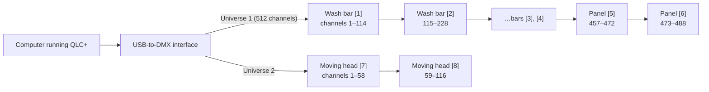
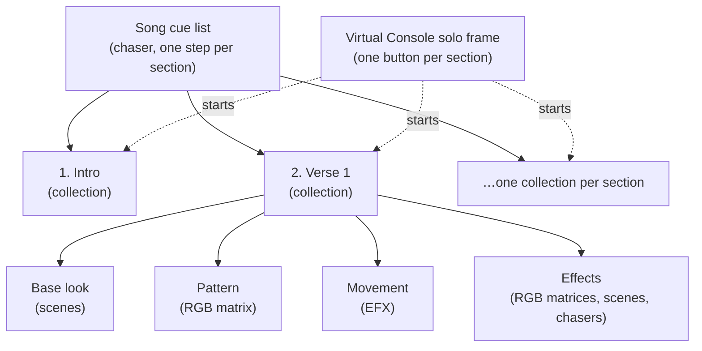
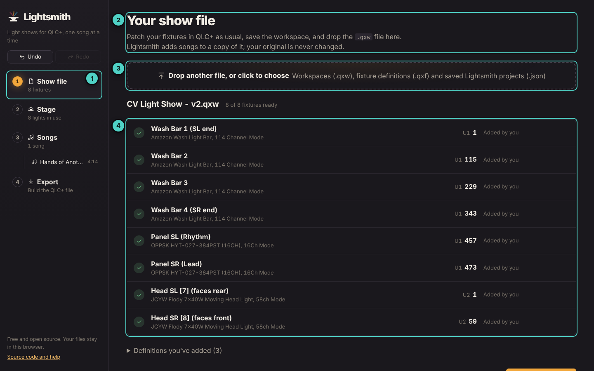
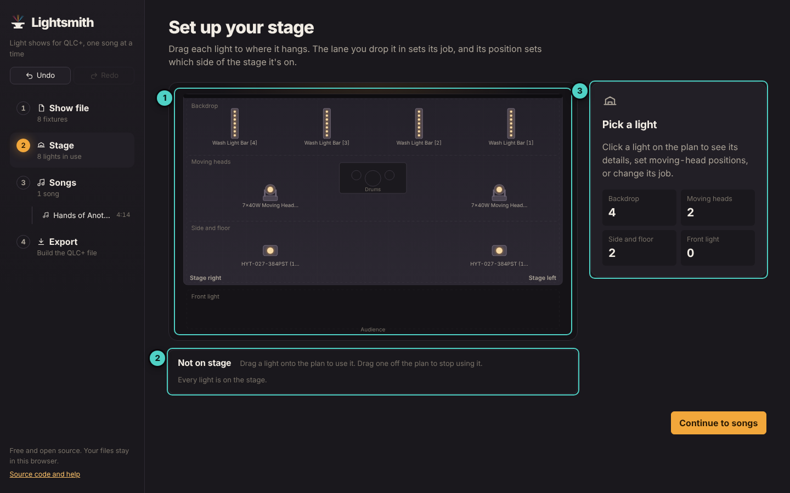
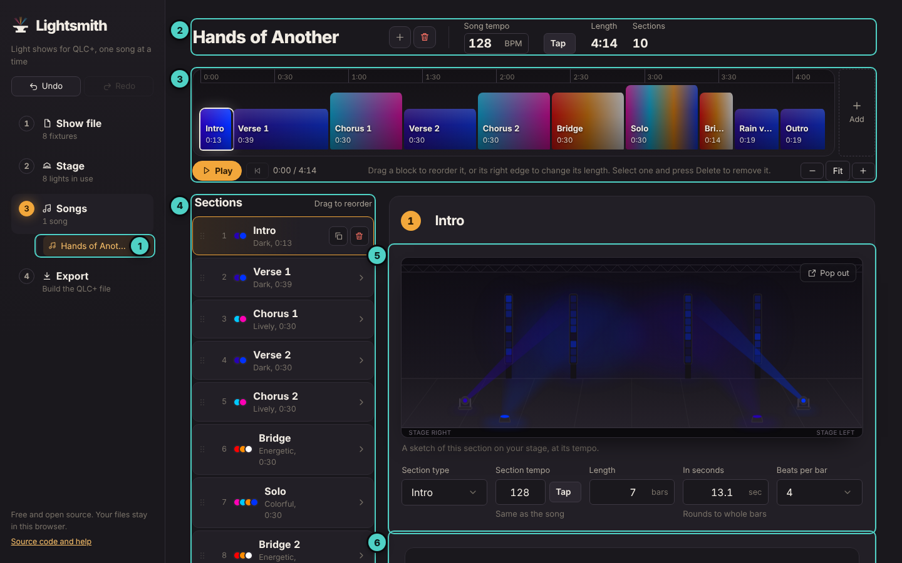
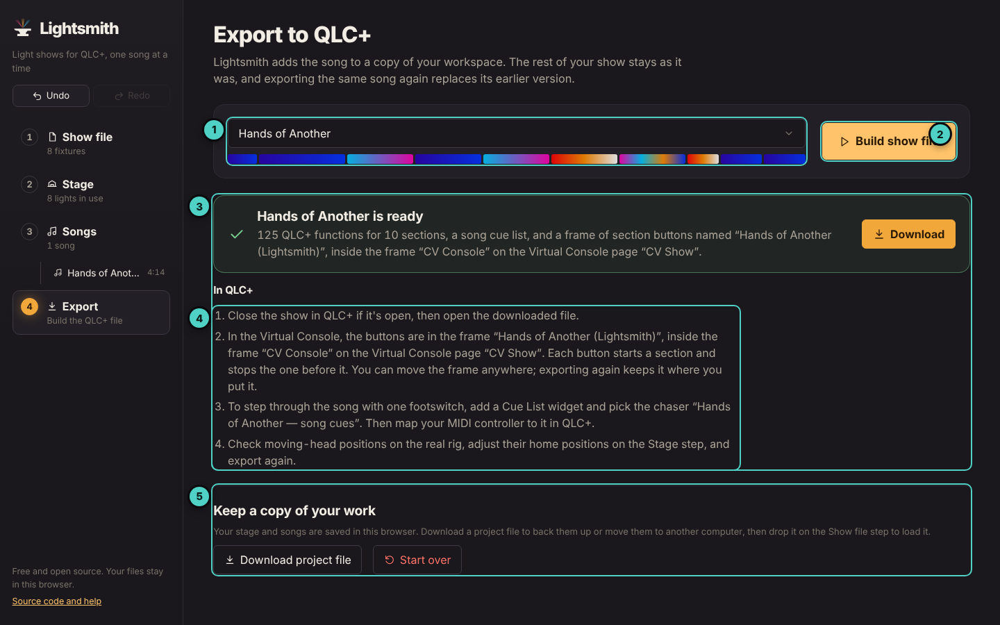
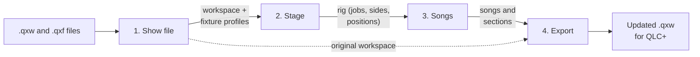
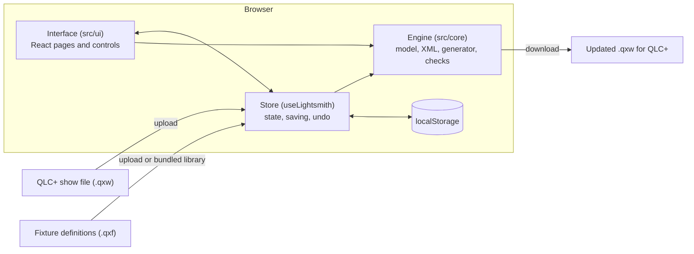
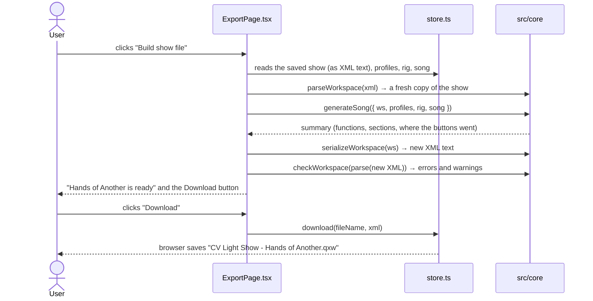

# Chapter 1. What we're building and how it fits together

> **Part 1 · Section A: Foundations**
> Previous: [Syllabus](00-syllabus.md) · Next: Chapter 2, Setting up the project

Before you write a line of code, you need to understand three things: the problem Lightsmith solves, the world it works in (stage lighting and QLC+), and how the app is put together to solve it. Every design decision in the rest of this course follows from those three things. When you're working on the app alone later, this is the chapter that tells you *why* the code is shaped the way it is.

There's no code to write in this chapter. You'll finish it with a mental model of the whole app, a vocabulary for lighting and QLC+, and a map of the codebase that the following chapters fill in.

## Goals

By the end of this chapter you'll be able to:

- Explain what Lightsmith does, for whom, and why it produces files instead of controlling lights.
- Use the lighting vocabulary the code relies on: DMX, universe, channel, fixture, mode, head, HTP and LTP.
- Name the QLC+ building blocks Lightsmith generates (scenes, chasers, collections, RGB matrices, EFX, the Virtual Console) and say what each is for.
- Walk through the app's four pages and say what data each one takes in and produces.
- Describe the app's architecture: an engine with no browser code, an interface built with React, and a store between them.
- Trace one user action, "Build show file", through the code from click to download.

---

## 1.1 The problem

Circular Vision is a rock band. Each song has a structure: intro, verse, chorus, verse, chorus, bridge, solo, outro. Each part has a mood: a moody verse, a big chorus, a frantic solo. The band owns a small lighting rig, and wants the lights to follow the song: dark blues in the verse, a burst of color when the chorus hits, a spotlight on the guitarist during the solo.

The lights are run by **QLC+**, a free, open-source lighting controller. QLC+ can do all of that, but programming it by hand is slow and fiddly. Every look is built from dozens of individual settings, then grouped, sequenced and wired to buttons. For a single five-minute song that's an evening of work, and a set has a dozen songs.

**Lightsmith turns song structure into QLC+ programming.** You describe the song in musical terms (sections, lengths, tempo, mood, energy, colors, effects), and Lightsmith generates the QLC+ content: the looks, the sequences and the buttons to trigger them. You open the result in QLC+, which runs the show.

Three decisions shape everything that follows:

1. **Lightsmith writes files; it never talks to the lights.** QLC+ already does the hard, hardware-specific work (talking to DMX interfaces, fixture definitions, MIDI controllers, the visualizer). Lightsmith's job is to produce correct QLC+ files, and nothing more. That keeps the app small and safe: it can't send a strobe to the wrong light in the middle of a show.
2. **It works on the user's existing show.** Bands have already patched their fixtures in QLC+, and may have hand-built scenes they love. Lightsmith adds to a *copy* of that show and never touches anything it didn't create.
3. **It starts from presets, and lets you fine-tune.** Users pick from moods, patterns and effects designed to look good on any rig, and get a good look in seconds. Where they want something specific, they can override it: a color for one kind of light, or a particular light's color and brightness. The long-term aim is for all the programming to happen in Lightsmith, with QLC+ handling the fixtures and DMX output.

---

## 1.2 Just enough stage lighting

You don't need to be a lighting technician, but the code uses lighting terms everywhere. Here they are, using the actual rig in this project.

### DMX: how lights are controlled

**DMX** (DMX512) is the standard control signal for stage lights. A controller, here a computer running QLC+ with a USB-to-DMX interface, sends a stream of numbers down a cable that runs from light to light.

- A **universe** is one DMX line: **512 channels**, each holding a value from **0 to 255**, sent many times a second.
- A **fixture** (a light) listens to a block of consecutive channels starting at its **address**.
- Each of those channels controls one thing: brightness, red, green, blue, pan, tilt, strobe and so on.

You can see this on the Show file page later in the chapter: "Wash Light Bar [1]" is at **U1 1** (universe 1, address 1) and uses 114 channels, so the next bar starts at **U1 115**. The two moving heads use 58 channels each and sit on a second universe, at **U2 1** and **U2 59**.

### Fixtures, modes and heads

- **Fixture definition.** A description of a light model: its channels, what each one does, and which values mean what. QLC+ stores these as `.qxf` files.
- **Mode.** Many lights offer several channel layouts. Your Wash Light Bar has a 114-channel mode with individual control of every pixel; a smaller mode might control the whole bar as one color. The mode in use decides what Lightsmith can do with the light.
- **Head.** A part of a fixture that can be colored on its own. A pixel bar has many heads; a moving head has one or a few. Patterns like "Falling rain" run across heads.
- **Common channel types** the code cares about:
  - **Master dimmer or intensity:** overall brightness.
  - **Color:** red, green and blue (sometimes white, amber, UV), one set per head.
  - **Pan and tilt:** where a moving head points, often with "fine" channels for precision.
  - **Shutter or strobe:** open, closed or strobing. Getting this wrong leaves a light dark, a trap documented in `docs/qlc-notes.md` and covered in Chapter 22.
  - **Speed:** how fast a moving head moves.

### When two things control the same channel: HTP and LTP

A light often has several looks running on it at once (a base color plus a flash effect, say). Controllers resolve that with two rules:

- **HTP, Highest Takes Precedence,** for intensity channels: the brighter value wins. If one look sets brightness to 40% and another to 100%, you get 100%.
- **LTP, Latest Takes Precedence,** for everything else (colors, positions): the most recently started look wins.

This matters more than it sounds. It's why Lightsmith's effects are set to *add* their light on top of a pattern rather than replace it, and why the order things start in matters. You'll meet both rules in the generator (Chapter 22).

### The rig in this project

| Fixture | Count | Mode | Job in Lightsmith |
|---|---|---|---|
| Amazon Wash Light Bar | 4 | 114 channels, many heads | **Backdrop:** a vertical wall of light behind the band |
| OPPSK HYT-027 LED panel | 2 | 16 channels | **Wash light:** washes on the players (stage left on the rhythm guitarist, stage right on the lead) |
| JCYW Flody moving head | 2 | 58 channels | **Moving heads:** beams that sweep and point |

Lightsmith never assumes this rig. Another band might have no backdrop, eight pars and a single moving head. Every feature has to work out what it can do from whatever lights are there, a principle you'll see in the rig code (Chapters 13 and 14).

---

## 1.3 Just enough QLC+

QLC+ (Q Light Controller Plus) keeps a whole show in one **workspace file**, `.qxw`. It's XML, which is good news: Lightsmith can read and write it with ordinary code.

### What QLC+ calls things

QLC+ builds shows from **functions**, its name for anything that can run. Lightsmith generates five kinds:

| QLC+ function | What it is | How Lightsmith uses it |
|---|---|---|
| **Scene** | A fixed set of channel values | A section's base look: colors and brightness for each light |
| **RGB matrix** | An animated pattern across many heads, driven by a script | Patterns such as "Falling rain" and "Waves", and effects such as "Sparkle" |
| **EFX** | A movement path for moving heads (circle, figure eight…) | Moving-head movement such as "Slow sweep" |
| **Chaser** | A sequence of steps, each running a function for a time | Color changes within a section, and the whole song as a step-by-step cue list |
| **Collection** | Several functions started together | One complete section: its scenes, pattern, movement and effects |

Two more QLC+ ideas complete the picture:

- **Fixture groups.** A named set of fixtures laid out in a grid. RGB matrices need one, because the pattern is drawn across the grid.
- **The Virtual Console.** QLC+'s on-screen control surface of buttons, sliders and frames, which can also be triggered by MIDI controllers and footswitches. A **solo frame** is a frame where starting one button stops the others, which is exactly what you want for song sections.

### What one song becomes

Here's what Lightsmith generates for a song, simplified:

Your *Hands of Another* song, with 10 sections, becomes 125 QLC+ functions, plus the cue list and a frame of buttons. That's the evening of hand-programming the app saves.

### The two file types

| File | Extension | Contains | Lightsmith… |
|---|---|---|---|
| Workspace (show file) | `.qxw` | Fixtures and their addresses, functions, fixture groups, the Virtual Console | Reads it, adds a song, and offers the updated copy for download |
| Fixture definition | `.qxf` | One light model: channels, modes, heads | Reads it to understand each light |

Both are XML. Chapter 11 builds the XML reader and writer; Chapter 12 uses them on real files.

---

## 1.4 A tour of the app, page by page

Lightsmith has four steps, shown in the left menu, and you go through them in order. The numbered callouts in each screenshot match the numbered list under it.

### Page 1: Show file

1. **The step menu.** The current step is highlighted, and each step shows a status line ("8 fixtures"). It's always visible, so you can jump between steps.
2. **The page heading and explanation.** Every page tells the user what to do in one or two plain sentences.
3. **The drop zone.** Drop or choose a QLC+ show file (`.qxw`), fixture definitions (`.qxf`) or a saved Lightsmith project (`.json`). The app works out which is which.
4. **The fixture list.** Every fixture in the show, with its address and definition status. A green tick means Lightsmith understands the light. A definition can come from the user or from the QLC+ fixture library bundled with the app.

**Takes in:** files. **Produces:** the parsed show and a *profile* of each light: what channels it has and what they do.

### Page 2: Stage

1. **The stage,** seen from above or from the audience, with every light where QLC+'s 3D view has it. Each light has a job (Backdrop, Moving head, Wash light or Front light), shown as a colored ring. Lightsmith guesses the jobs; the user can change them, and can drag a light to move it. Where a light is decides which side of the stage it's on, but never its job.
2. **The tray** for lights that aren't used.
3. **The inspector.** Details of the selected light: its job, where it is, mounting, which way a moving head faces, home position and more. With nothing selected, it shows a summary of the rig.
4. **Moving-head positions,** below the stage: named places for the heads to point, such as "X over the drums", picked per section on the Songs page.

**Takes in:** the light profiles and QLC+'s 3D view. **Produces:** the **rig**: each light's job, and its position, height, side and order.

### Page 3: Songs

1. **The song list,** under "3. Songs" in the menu.
2. **The song header:** title, add and delete buttons, song tempo (with a Tap button), length and section count.
3. **The timeline.** One block per section, sized by length, with taller blocks for more energy. Drag to reorder, drag a block's edge to resize it, and use Play to watch the song.
4. **The section list.** The same sections as numbered tiles, with duplicate and delete buttons.
5. **The selected section's stage preview** and its basic settings (type, tempo with Tap, length in bars or seconds, beats per bar). The preview is an animated sketch on the user's own rig, and can pop out into a floating window.
6. **The section's settings cards,** below the preview: Mood and energy, Colors, Individual lights, Pattern, Moving heads (where they point, movement and beam), Focus, Effects, and Start and end. Each card can be closed to a one-line summary, and stays closed as you move between sections.

**Takes in:** the rig. **Produces:** **songs**, each a list of **sections** with all their settings.

### Page 4: Export

1. **The song to export,** with a strip showing its sections' colors.
2. **Build show file** runs the generator.
3. **The result:** what was created and where the buttons are, plus **Download** for the updated show file.
4. **Next steps in QLC+.**
5. **Keep a copy of your work:** download the project (stage and songs) as a file, or start over.

**Takes in:** the original show file, the rig and a song. **Produces:** an **updated `.qxw`** for QLC+.

### The journey as data

Each page produces something the next one needs:

Keep this picture in mind: the course builds the app in exactly this order.

---

## 1.5 The architecture

### Two halves: an engine and an interface

Lightsmith's code is split into two folders with a strict rule between them.

| | `src/core`: the engine | `src/ui`: the interface |
|---|---|---|
| **Written in** | Plain TypeScript | TypeScript with React components |
| **Knows about** | Shows, fixtures, songs, QLC+ XML | Screens, clicks, drags, the browser |
| **Never touches** | The browser, React, the screen | QLC+ file formats directly |
| **Main files** | `model.ts`, `presets.ts`, `xml.ts`, `fixture.ts`, `workspace.ts`, `rig.ts`, `generate.ts`, `checks.ts`, `history.ts` | `App.tsx`, one file per page, `store.ts`, controls, the stage preview, `styles.css` |
| **Tested by** | `tests/core.test.ts` (about 20 tests) | You, in a browser (for now) |

**The rule: `src/core` never imports anything from `src/ui`.** The interface uses the engine, never the other way round.

Why that rule matters:

- **Testing.** The engine runs in Node with no browser, so the tests can check real exports in milliseconds.
- **Reuse.** The engine doesn't care what's driving it. Today it's a React page; in Part 2 the same files run on a server, unchanged.
- **Thinking.** When something's wrong with an export, you look in `src/core`. When something looks or behaves wrong on screen, you look in `src/ui`.

*Coming from PHP:* think of `src/core` as your model and service classes, and `src/ui` as your templates and controllers. The difference is that everything here runs in the user's browser.

### The store between them

Between the pages and the engine sits the **store**: one React hook, `useLightsmith` in `src/ui/store.ts`. Every page gets its data from the store and sends every change through it. The store:

- holds the loaded show, the fixture definitions and the project (rig plus songs);
- saves them in the browser's `localStorage`, so work survives a reload;
- keeps the undo and redo history;
- turns dropped files into data by calling the engine's parsers.

The interface also calls the engine directly for pure calculations, like a section's length or how bright its lights should be. That's fine: those are calculations, not changes, so they don't need to go through the store.

### Following one click: "Build show file"

Here's what happens, in order, when the user clicks **Build show file** on the Export page. Each name is a real function you can search for.

Notice what the page does **not** do: it doesn't know anything about scenes, chasers or XML elements. It hands data to the engine and shows what comes back. Notice too that it parses a *fresh* copy of the saved show for every build, so the original is never changed. The engine changes the copy it's given, which is a detail Chapter 24 comes back to.

### Why browser-only, for now

Lightsmith version 1 has no server: the GitHub Pages site serves the app's files and nothing else, and everything happens in the user's browser.

- **Nothing to run or pay for.** Static hosting is free, and there's no server or database to look after.
- **Privacy.** A band's show file never leaves their computer.
- **Speed of building.** No accounts, APIs or deployments to design before the useful part works.

The trade-offs are real, and they're what Part 2 addresses:

- Work lives in one browser on one computer. Clearing browser data loses it, unless the user downloaded a project file.
- No accounts, sharing or syncing between devices.
- Nothing can be kept secret. Every line of code ships to the browser, so features that need private API keys (payments, AI) are impossible without a server.

---

## 1.6 The repository at a glance

You'll set this up yourself in Chapter 2. For now, here's the map:

| Path | What's there | Covered in |
|---|---|---|
| `src/core/` | The engine | Chapters 9, 11–14, 22 |
| `src/ui/` | The interface: shell, pages, controls, store, styles | Chapters 8, 10, 12–22 |
| `src/main.tsx` | Starts the app in the browser | Chapter 2 |
| `src/config.ts` | The app's name and GitHub address | Chapter 2 |
| `tests/` | Engine tests and the small made-up fixtures they use | Chapters 11, 22 |
| `scripts/sync-fixtures.mjs` | Copies the QLC+ fixture library into the app at build time | Chapter 12 |
| `public/` | Files served as they are (the favicon, the fixture library) | Chapters 2, 12 |
| `docs/qlc-notes.md` | QLC+ behavior learned the hard way | Chapter 22 |
| `.github/workflows/deploy.yml` | Tests, builds and publishes the site on every push | Chapter 23 |
| `course/` | This course | — |
| `package.json`, `tsconfig.json`, `vite.config.ts`, `index.html` | Project and build settings | Chapter 2 |

---

## 1.7 Vocabulary

| Term | Meaning in this course |
|---|---|
| **DMX, universe, channel, address** | The control signal; one 512-channel line; one controllable value (0–255); where a fixture's channels start |
| **Fixture, definition, mode, head** | A light; its description (`.qxf`); its chosen channel layout; a separately colorable part |
| **HTP / LTP** | Brightest wins (intensity) / most recent wins (everything else) |
| **Workspace (`.qxw`)** | A QLC+ show file |
| **Function** | Anything QLC+ can run: scene, chaser, collection, RGB matrix, EFX |
| **Virtual Console, solo frame** | QLC+'s button surface; a frame where one button runs at a time |
| **Profile** | Lightsmith's summary of what a fixture can do in its mode |
| **Rig** | Lightsmith's record of each light's job, side, order and position |
| **Song, section** | A song is a list of sections; a section is one part (verse, chorus…) with all its lighting settings |
| **Engine / interface / store** | `src/core` / `src/ui` / the `useLightsmith` hook that connects them |

---

## Build it

This chapter's work is thinking and exploring, not coding.

1. **Use the live app.** Open [jastylr.github.io/lightsmith](https://jastylr.github.io/lightsmith/), load your show, and walk through all four steps. Build and download one song.
2. **Sketch the pages.** On paper, sketch each page. For each, write what data it needs and what it produces. Compare with the diagram in section 1.4.
3. **Explore the repository on GitHub.** Without running anything:
   - Open `src/core/index.ts` and list the engine's files.
   - Open `src/ui/ExportPage.tsx` and find the `build` function. Match each line to a step in the sequence diagram in section 1.5.
   - Search the repository for `from "../ui` inside `src/core`. You should find nothing; that's the rule from section 1.5 holding.
4. **Find the arithmetic.** In your own `.qxw` (open it in a text editor), find the `<Fixture>` elements and their `<Universe>`, `<Address>` and `<Channels>`. Check that each fixture's address plus its channel count gives the next fixture's address. QLC+ counts both universes and addresses from 0 in the file, so "U1 1" on screen is stored as universe `0`, address `0`, and "U1 115" as address `114`. (The app shows them counted from 1, as lighting people do.)

## Check yourself

1. Why does Lightsmith write files instead of sending DMX to the lights?
2. A fixture at U1 115 uses 114 channels. Where can the next fixture start?
3. A base scene sets a bar's dimmer to 40% and a flash effect sets it to 100%. What brightness do you see, and which rule decides? What if both set the bar's *color*?
4. What does a solo frame guarantee, and why is that right for song sections?
5. Which folder would you open to fix an export that puts the wrong color on a light? To fix a button that's in the wrong place on screen?
6. Name two things the browser-only design makes impossible, and one thing it makes easy.

Answers

1. QLC+ already handles the hardware, the fixture library, MIDI and the visualizer. Writing files keeps Lightsmith small, testable and unable to do anything unsafe during a live show.
2. At U1 229 (115 + 114).
3. 100%, because intensity is HTP: the highest value wins. For color, LTP applies, so whichever look started most recently wins. That's why Lightsmith's effects add their light on top rather than relying on start order.
4. Only one button in the frame runs at a time; starting one stops the others. A song is in exactly one section at a time.
5. Wrong color: `src/core` (the generator). Misplaced button: `src/ui`.
6. Impossible: syncing between devices, accounts, keeping API keys secret (so payments and server-side AI). Easy: free hosting, privacy, nothing to operate.

---

**Next: Chapter 2. Setting up the project.** You'll install the tools, create your own copy of the app from an empty folder, and set up the same structure, settings and defaults Lightsmith uses.
